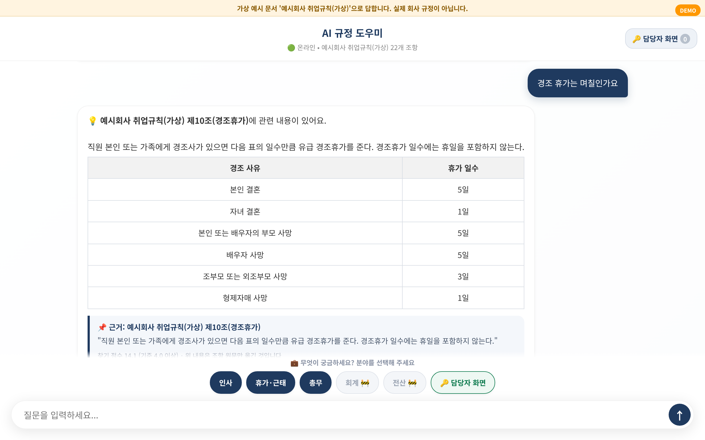
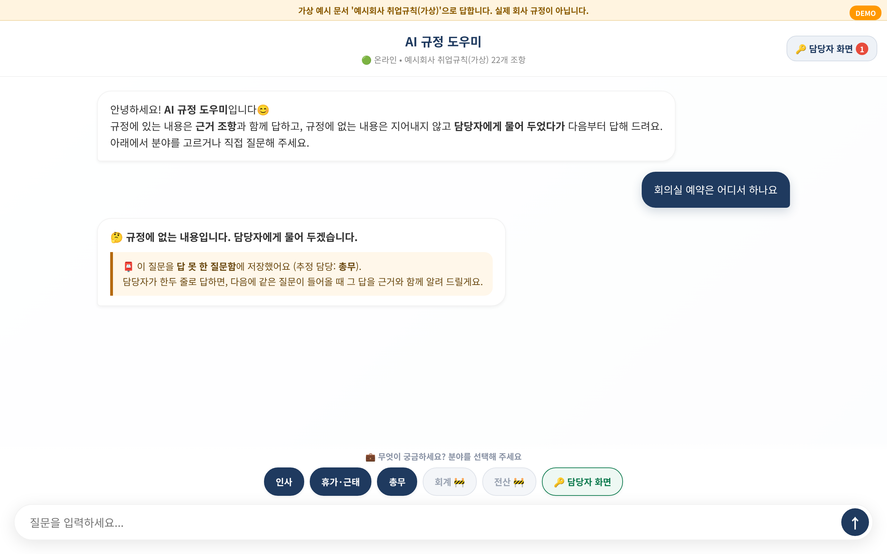
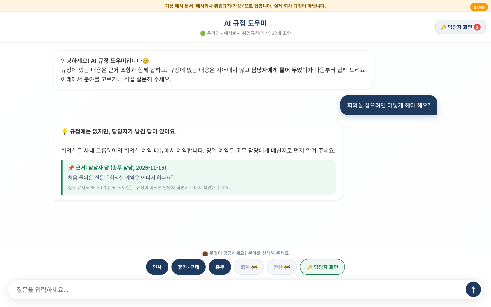

# 문서에 없는 답을 쌓는 사내 Q&A 데모

> [!IMPORTANT]
> **접속 암호: `aigen`** · 첫 화면에 이 암호를 넣으면 바로 써 볼 수 있다(대소문자 구분 없음).

규정 챗봇은 문서 안에서만 답한다. 문서에 없는 답은 사람에게만 있고, 바쁜 사람은 처음부터 적을 시간이 없다. 이 데모는 챗봇이 답하지 못한 질문을 모아 아는 사람에게 짧게 묻고, 그 답을 쌓아 다음 질문에 쓰는 흐름을 시험한다.

| 규정에 있는 질문 | 규정에 없는 질문 | 담당자 답 다시 쓰기 |
|---|---|---|
|  |  |  |

## 바로 써 보기

세 가지 방법 중 하나를 고른다. 어느 방법이든 첫 화면에 접속 암호를 넣는다: **`aigen`**

1. **브라우저로 열기 (가장 쉬움):** 이 저장소를 내려받아 `web/index.html`을 더블클릭한다. 설치, 서버, 회원가입이 필요 없다.
2. **실행파일:** [Releases](../../releases)에서 운영체제에 맞는 zip을 받아 풀고 실행한다. 내 컴퓨터 안에서만 열리는 서버가 뜨고 브라우저가 자동으로 열린다. 검은 창을 닫으면 종료된다.
   - 개인 프로젝트라 코드 서명이 없다. Windows에서 'Windows의 PC 보호' 창이 뜨면 '추가 정보 → 실행'을, macOS에서 막히면 파일을 오른쪽 클릭해 '열기'를 누른다. 불안하면 1번이나 3번 방법을 쓴다.
   - 받은 파일이 올린 파일과 같은지는 Releases의 `SHA256SUMS.txt`로 확인할 수 있다.
3. **직접 빌드:** Go 1.25 이상에서 `go run .` 또는 `sh scripts/build.sh v1.0.0` (Windows는 `scripts\build.ps1`).

## 해 볼 것

1. '휴가·근태 → 경조 휴가'를 누른다. 조항 내용과 함께 근거 조항 번호와 원문 일부가 나온다.
2. '총무 → 회의실 예약'을 누른다. 규정에 없으므로 지어내지 않고 '규정에 없는 내용입니다. 담당자에게 물어 두겠습니다.'라고 답하고, 질문을 '답 못 한 질문함'에 저장한다.
3. 오른쪽 위 '담당자 화면'에서 그 질문에 한두 줄로 답하고 저장한다. 사람 이름 대신 역할(예: 총무 담당)만 남는다.
4. 챗봇으로 돌아와 '회의실 잡으려면 어떻게 해야 해요?'처럼 표현을 바꿔 묻는다. 담당자 답이 '담당자 답 (총무 담당, 날짜)' 근거와 함께 나온다.

## 동작 구조

```
질문 ─┬─ 담당자 답과 비슷한가? (유사도 50% 이상) ──▶ 담당자 답 + 근거(역할, 날짜)
      ├─ 규정 조항에서 근거를 찾았나? (점수 4.0 이상, 핵심어 50% 이상) ──▶ 조항 원문 + 근거(조항 번호)
      └─ 둘 다 아니면 ──▶ '규정에 없음' + 답 못 한 질문함에 저장(시각, 질문, 추정 담당 분야)
                                   │
                         담당자 화면에서 한두 줄 답 ──▶ 지식에 추가 ──▶ 다음 질문부터 사용
```

- 찾기: 조항 단위 키워드 점수(BM25 방식)를 브라우저 안에서 계산한다. 동의어 표(연차=연차유급휴가, 출장비=여비, 월급=임금 등)를 함께 쓴다.
- 저장: 브라우저 저장소(localStorage). 담당자 화면에서 JSON으로 내보내고 불러올 수 있다.
- 답 만들기: 조항 원문과 담당자 답만 옮긴다. 화면은 생성형 AI를 쓰지 않으므로 지어낸 답이 나오지 않는다.

## 폴더 구조

```
web/index.html     데모 화면 (이 파일 하나로 동작)
main.go            실행파일: web 폴더를 안에 넣고 127.0.0.1에서만 여는 서버, 브라우저 자동 실행
api/               생성형 AI를 붙이는 자리 (아래 설명)
  provider.go        AI 연결부의 공통 틀(Provider)과 기본값(None, AI 꺼짐)
  claude.go          Claude API 연결부 (근거 안에서만 답하게 지시)
  handler.go         /api/status, /api/ask
  api_test.go        서버 시험 8건
docs/              화면 시험 기록(test-log.md)과 화면 캡처
scripts/           빌드 스크립트
.env.example       AI 설정 예시 (실제 키는 .env에, .env는 올리지 않음)
```

## 생성형 AI 붙이기 (`api/`)

키워드 검색은 말을 크게 바꾸면 놓친다. 다음 단계는 생성형 AI로 의미를 이해하게 하되, 지금의 원칙(근거 없는 답은 내지 않는다)을 그대로 지키는 것이다. `api/`는 그 연결 자리다.

**켜는 법**

1. `.env.example`을 복사해 이름을 `.env`로 바꾸고 실행파일과 같은 폴더에 둔다.
2. `AI_PROVIDER=claude`, `ANTHROPIC_API_KEY=본인 키`를 적는다. 모델은 비워 두면 `claude-opus-5-5`.
3. 실행하면 검은 창에 'AI 연결: claude'가 보인다. 설정이 없거나 키가 비면 AI 없이 동작한다.

**주고받는 형식**

```
GET  /api/status  →  {"enabled": true, "provider": "claude", "model": "claude-opus-5-5"}

POST /api/ask
{"question": "결혼하면 휴가 며칠?",
 "snippets": [{"source": "제12조(경조 휴가)", "text": "본인 결혼 5일 ..."}]}
→ {"found": true, "text": "본인 결혼 시 5일입니다 [1].", "sources": ["제12조(경조 휴가)"], "provider": "claude"}
```

**AI에 거는 원칙**

- 근거(snippets)가 없으면 AI를 부르지 않는다.
- 근거 밖의 사실, 숫자, 날짜는 만들지 말고, 답할 수 없으면 `NOT_FOUND`만 내게 한다. 이때 `found`는 `false`다.
- 답한 문장에는 근거 번호를 붙이게 하고, 그 번호를 근거 이름으로 바꿔 돌려준다.
- 다른 회사 AI를 쓰려면 `Provider` 틀에 맞춰 연결부를 하나 더 만들면 된다.

**지금 상태:** 서버 쪽 연결부와, 가짜 Claude 서버로 요청 모양과 답 해석을 확인하는 시험까지 했다. 화면에 연결하는 일과 실제 키로 품질을 확인하는 일은 아직이다.

## 보안 원칙

- API 키는 저장소와 실행파일 어디에도 없다. 쓰는 사람이 자기 `.env`에 넣고, `.env`는 `.gitignore`로 올라가지 않게 막았다.
- 서버는 `127.0.0.1`(내 컴퓨터)에서만 열린다. 같은 와이파이의 다른 기기에서는 접속할 수 없다.
- `/api/ask`는 다른 웹사이트에서 온 요청(Origin이 다른 요청)과 JSON이 아닌 요청을 거부하고, 요청 크기와 질문 길이를 제한한다. 다른 사이트가 내 키로 몰래 AI를 부르지 못하게 하기 위해서다.
- 데이터는 '예시회사 취업규칙(가상)' 22개 조항이다. 근로기준법 수준의 일반 내용으로 새로 쓴 가상 문서이며, 실제 회사 규정이 아니다. 담당자 답 예시(회의실, 택배)도 시험용 가상 내용이다.

## 시험

- 화면: `docs/test-log.md`. 14건 중 14건 통과(규정 안 6, 규정 밖 4, 담당자 답 다시 묻기 4).
- 서버: `go test ./...`로 8건 통과. 기본값은 AI 꺼짐, 꺼져 있으면 503, 다른 사이트 요청 거부, JSON만 받기, 빈 질문 거부, 정상 답 전달, Claude 요청 모양(모델, 거절 시 대체 모델 설정)과 근거 번호 해석, 근거가 없으면 AI를 부르지 않기.

## 한계

- 키워드 방식이라 말을 크게 바꾸면 놓친다(예: '아파서 못 나가면'은 병가 조항을 찾지 못함). 위의 `api/`가 이를 풀기 위한 다음 단계다.
- 담당자 답이 맞는지, 규정이 바뀐 뒤에도 유효한지는 사람이 다시 확인해야 한다.
- 실제 동료가 답해 본 결과는 아직 없다. 다음 단계는 묻는 방식이 통하는지 동료에게 써 보게 하는 것이다.

## 화면 구성의 바탕

- 화면 비율 자동 맞춤(휴대폰, 태블릿, PC), 접속 암호, 분야별 퀵메뉴와 준비 중 표시, 답변 안의 표와 흐름도, 외부 라이브러리가 막혀도 동작하는 대체 표시, 입력 영역 높이에 맞춘 여백 계산은 김태원이 혼자 기획하고 개발한 사내 규정 챗봇의 화면 코드를 참고해, 이 포트폴리오 데모에 맞게 각색했다.
- 각색하면서 회사 이름, 회사 업무가 드러나는 메뉴, 서버 연결, 실제 암호는 넣지 않았다.
- 이번에 더한 것: 답 못 한 질문함, 담당자 화면, 담당자 답 재사용, 브라우저 안 찾기 엔진, 가상 규정 데이터, 실행파일, AI 연결 자리.

## 역할

- 기획과 기능 설계, 테스트와 수정 판단: 김태원
- 화면과 기본 구조: 김태원이 혼자 개발한 사내 규정 챗봇의 화면 코드(AI에 지시해 구현)를 참고해 데모에 맞게 각색
- 질문함, 담당자 화면, 찾기 엔진, 실행파일, AI 연결 자리 구현: Claude에 지시해 추가. 실행파일 배포와 AI 연결 자리는 개발자 지인의 조언을 반영함

## 라이선스

MIT
